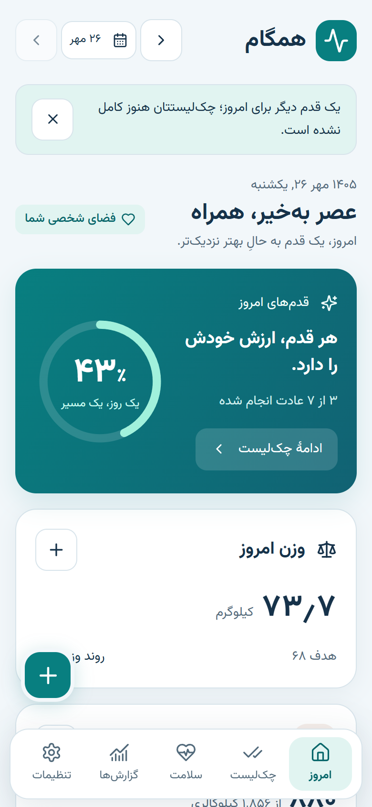
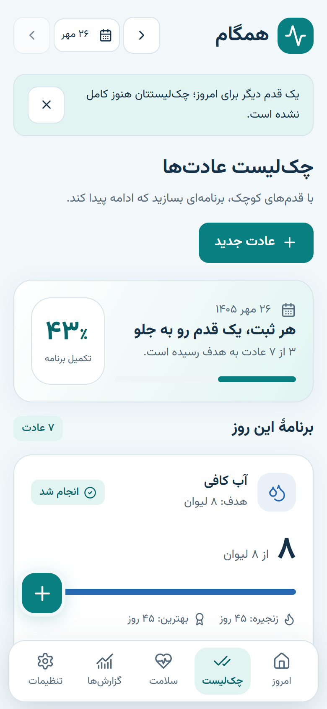
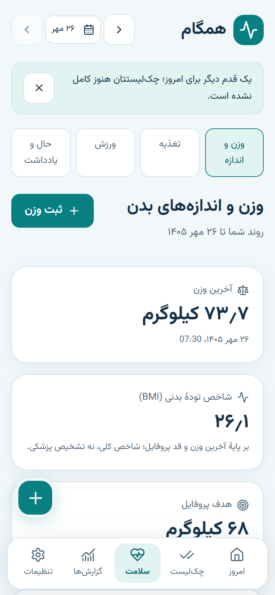
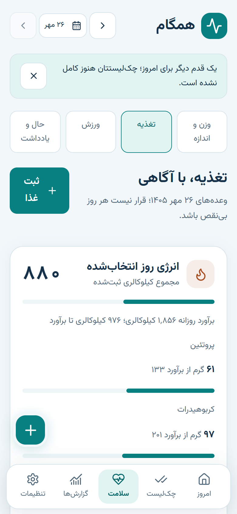
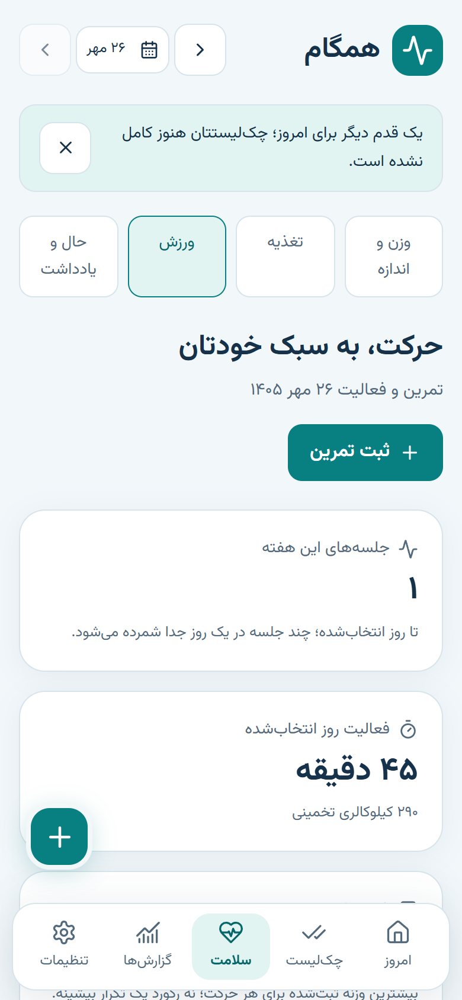
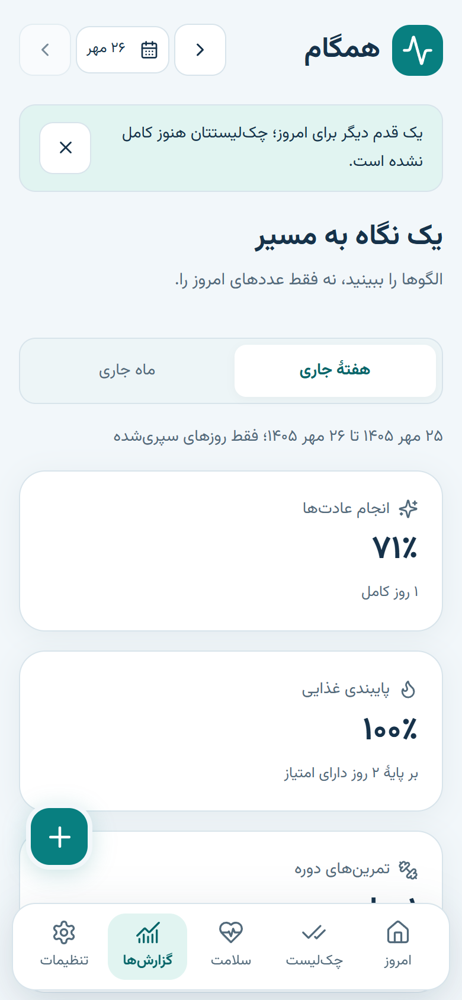
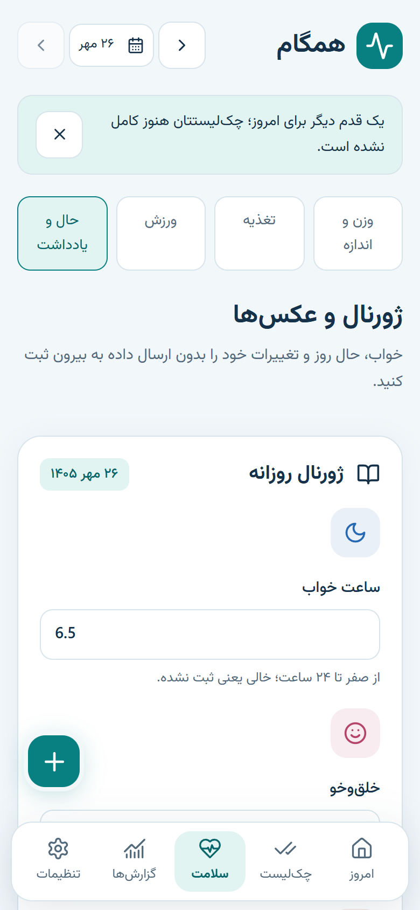
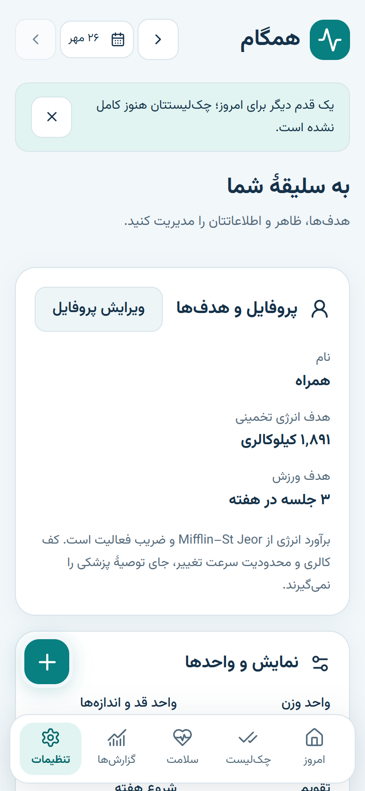
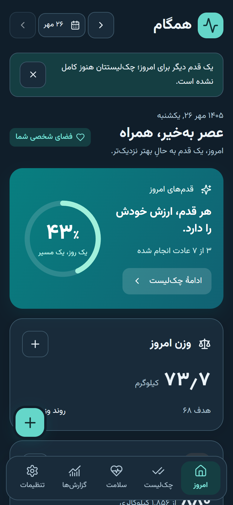

# همگام — Fit Tracker PWA

<div dir="rtl">

**همگام** یک اپلیکیشن وب پیش‌رونده (PWA) فارسی و موبایل‌محور برای پیگیری روزانهٔ چک‌لیست عادت‌ها، وزن، تغذیه و ورزش است. همهٔ داده‌ها **فقط روی دستگاه خودتان** ذخیره می‌شود؛ هیچ سرور، حساب کاربری یا ارسال داده‌ای وجود ندارد و برنامه کاملاً **آفلاین** کار می‌کند.

</div>

<p align="center">
  
  
  
</p>
<p align="center">
  
  
  
</p>
<p align="center">
  
  
  
</p>

---

<div dir="rtl">

## فهرست

- [ویژگی‌ها](#ویژگیها)
- [تصاویر](#تصاویر)
- [اجرای محلی](#اجرای-محلی)
- [ساخت نسخهٔ نهایی](#ساخت-نسخهٔ-نهایی)
- [انتشار روی GitHub Pages](#انتشار-روی-github-pages)
- [نصب روی آیفون و اندروید](#نصب-روی-آیفون-و-اندروید)
- [پشتیبان‌گیری و بازگردانی](#پشتیبانگیری-و-بازگردانی)
- [حریم خصوصی](#حریم-خصوصی)
- [ساختار پروژه](#ساختار-پروژه)
- [توسعه و آزمون](#توسعه-و-آزمون)

## ویژگی‌ها

### امروز

داشبورد روزانه با سلامِ ساعت‌محور، تاریخ جلالی/میلادی، حلقهٔ درصد تکمیل روز، ثبت سریع وزن، خلاصهٔ کالری و درشت‌مغذی‌ها، آب، وضعیت ورزش، استریک و یک جملهٔ انگیزشی چرخشی. رسیدن به ۱۰۰٪ تکمیل روز با انیمیشن کاغذرنگی جشن گرفته می‌شود.

### چک‌لیست عادت‌ها

- ساخت عادت با نام، آیکون، رنگ، روزهای هفته، هدف روزانه و ترتیب دلخواه؛ ویرایش، جابه‌جایی و آرشیو.
- هفت قالب آماده: آب، تغذیه، ورزش، خواب، قدم‌ها، ویتامین و بدون قند.
- استریک هر عادت، درصد تکمیل و **نقشهٔ حرارتی تقویمی**.
- تاریخ حفظ می‌شود: تغییر قالب یک عادت، گذشته را بازنویسی نمی‌کند (نسخه‌های تنظیمات عادت + هدف ثبت‌شده در هر گزارش روز).

### وزن و اندازه‌ها

- ثبت روزانهٔ وزن با ساعت و یادداشت.
- نمودار وزن خام + **میانگین متحرک ۷ روزه** + خط هدف؛ بازه‌های ۷/۳۰/۹۰ روز و همه.
- تغییر هفتگی و ماهانه، BMI، و تخمین تاریخ رسیدن به هدف.
- ثبت اختیاری پنج اندازهٔ بدن (دور کمر، سینه، بازو، ران، گردن) با نمودار جداگانه.

### تغذیه

- چهار وعده (صبحانه، ناهار، عصرانه، شام) با کالری سریع و درشت‌مغذی اختیاری.
- کتابخانهٔ غذاهای سفارشی با علاقه‌مندی‌ها و آخرین‌های استفاده‌شده.
- درجهٔ پایبندی به رژیم، علامت وعدهٔ تقلبی، و پیگیری آب.
- نمودار کالری روزانه و هفتگی در برابر هدف.

### ورزش

- ثبت تمرین با نوع، مدت، شدت، کالری تخمینی (MET) و یادداشت.
- ست/تکرار/وزنه اختیاری برای تمرین‌های قدرتی.
- روتین‌ها و قالب‌های تمرینی قابل استفادهٔ دوباره، روز استراحت و هدف هفتگی.
- رکوردهای شخصی و نمودار حجم تمرین هفتگی.

### حال، خواب و روزنگار

- خواب شبانه، حال و انرژی (۱ تا ۵)، یادداشت روزانه.
- عکس‌های پیشرفت که **فقط محلی** ذخیره می‌شوند، با مقایسهٔ کناربه‌کنار.

### گزارش‌ها

خلاصهٔ هفتگی و ماهانه، درصد پایبندی، بهترین استریک‌ها، نشان‌های دستاورد و سرنخ‌های هم‌بستگی (مشاهده‌ای، نه علّی).

### تنظیمات

پروفایل و اهداف، واحدها (کیلوگرم/پوند، سانتی‌متر/اینچ)، تقویم (جلالی/میلادی)، ارقام فارسی یا لاتین، شروع هفته (شنبه تا دوشنبه)، روشن/تاریک/سیستم، یادآور درون‌برنامه‌ای، پشتیبان JSON، خروجی CSV، دادهٔ نمونه، بازنشانی و راهنمای نصب.

### تجربهٔ کاربری

راست‌به‌چپ کامل، فونت وزیرمتن میزبانی‌شده (بدون CDN)، هدف لمسی حداقل ۴۴ پیکسل، حالت شب، رعایت safe-area، بدون اسکرول افقی، احترام به `prefers-reduced-motion` و کنتراست بالا، حالت‌های خالی و اسکلتون.

## تصاویر

فایل‌های `docs/screenshots/*.png` با اسکریپت `scripts/screenshots.mjs` (Playwright، اندازهٔ آیفون ۳۹۰×۸۴۴، دو برابر چگالی) به‌صورت خودکار از نسخهٔ تولید گرفته می‌شوند.

```bash
npm run preview -- --port 4173
node scripts/screenshots.mjs
```

## اجرای محلی

نیازمندی: Node.js 20 یا بالاتر.

```bash
npm install
npm run dev
```

سپس آدرس چاپ‌شده (به‌طور پیش‌فرض `http://localhost:5173/`) را باز کنید. در اولین اجرا، جادوگر سه‌مرحله‌ای قد، وزن، سن، جنسیت، سطح فعالیت و هدف را می‌پرسد و کالری و درشت‌مغذی‌های روزانه را با فرمول **Mifflin-St Jeor** حساب می‌کند. برای دیدن برنامه با داده‌های نمونهٔ ۴۵ روزه، در همان مرحله گزینهٔ «ابتدا با دادهٔ نمونه ببینم» را انتخاب کنید.

نکته‌های ایمنی محاسبات:

- کف کالری برای آقایان ۱۵۰۰ و برای بانوان ۱۲۰۰ کیلوکالری است.
- سرعت کاهش وزن بیش از **۱٪ وزن بدن در هفته** پذیرفته نمی‌شود.
- برای سن زیر ۱۸ یا بالای ۱۰۰ و در حالت‌های خاص (بارداری، شیردهی، شرایط پزشکی) هدف کالری ساخته نمی‌شود و برنامه فقط پیگیری می‌کند.
- این برنامه ابزار خودمراقبتی است و جای مشاورهٔ پزشکی را نمی‌گیرد.

## ساخت نسخهٔ نهایی

```bash
npm run build
npm run preview
```

خروجی در `dist/` ساخته می‌شود؛ شامل `manifest.webmanifest`، سرویس‌ورکر `sw.js` و آیکون‌های ۱۹۲/۵۱۲/ماسکبل. برای بازتولید آیکون‌ها:

```bash
node scripts/generate-icons.mjs
```

## انتشار روی GitHub Pages

مخزن شامل `.github/workflows/deploy.yml` است که روی هربار push به `main` این کارها را انجام می‌دهد: `npm ci`، lint، بررسی قالب، آزمون‌ها، build و در نهایت انتشار خروجی روی GitHub Pages.

مراحل یک‌باره:

1. **Settings → Pages → Build and deployment → Source: GitHub Actions**.
2. اگر نام مخزن شما با `fit-tracker-pwa` فرق دارد، `base` را در `vite.config.ts` و `start_url`/`scope`/`id` مانیفست را با نام جدید هم‌راستا کنید.
3. پس از پایان اولین اجرای workflow، نشانی زندهٔ برنامه: `https://<username>.github.io/<repo>/`.

برنامه از `HashRouter` استفاده می‌کند تا نشانی‌های داخلی روی Pages بدون تنظیم ۴۰۴ کار کنند، و ناوبری آفلاین با `navigateFallback` سرویس‌ورکر پوشش داده شده است.

## نصب روی آیفون و اندروید

**آیفون (Safari):** برنامه را در Safari باز کنید ← دکمهٔ Share ← Add to Home Screen ← Add.

**اندروید (Chrome):** برنامه را در Chrome باز کنید ← منوی سه‌نقطه ← Install app (یا نوار پیشنهاد نصب) ← Install.

پس از نصب، برنامه تمام‌صفحه باز می‌شود و بدون اینترنت هم کار می‌کند.

## پشتیبان‌گیری و بازگردانی

- **تنظیمات → پشتیبان‌گیری → دریافت پشتیبان JSON**: کل داده‌ها (پروفایل، تنظیمات، عادت‌ها، گزارش‌ها، وزن، تغذیه، ورزش، عکس‌ها) را در یک فایل می‌دهد. عکس‌ها به‌صورت JPEG درون همان فایل هستند.
- **دریافت CSV**: برای تحلیل در اکسل؛ ستون‌های حساس با `'` محافظت شده‌اند تا Excel آن‌ها را فرمول اجرا نکند.
- **بازگردانی**: فایل پشتیبان انتخاب می‌شود، اعتبارسنجی کامل (ساختار، شناسه‌های تکراری، ارجاع‌های نامعتبر، تاریخ‌ها، سلامت عکس‌ها) انجام می‌شود و سپس **در یک تراکنش اتمی** جایگزین می‌شود؛ اگر اعتبارسنجی رد شود، هیچ داده‌ای پاک نمی‌شود.

پیشنهاد: هر چند هفته یک پشتیبان بگیرید و در جای دیگری نگه دارید، چون پاک‌کردن داده‌های مرورگر یا حذف برنامه داده‌ها را از بین می‌برد.

## حریم خصوصی

هیچ سروری وجود ندارد و هیچ داده‌ای جایی فرستاده نمی‌شود. برنامه از GitHub Pages سرو می‌شود، پس همان دامنه می‌تواند درخواست‌های دیگرش را ببیند؛ ولی خودِ داده‌های شما در IndexedDB همین مرورگر می‌ماند. فایل پشتیبان رمزنگاری نشده است — آن را در جای امن نگه دارید.

## ساختار پروژه

```
src/
  components/   اجزای مشترک رابط (کارت، دکمه، مودال، نمودار، چیدمان)
  db/           Dexie/IndexedDB: طرح جدول‌ها، نوشتن‌ها، پشتیبان و بذر داده
  features/     هر بخش محصول: today، onboarding، habits، weight، diet،
                exercise، journal، reports، settings
  hooks/        هوک‌های مشترک (useData، useUI، دسترسی به دستگاه)
  lib/          توابع خالص: محاسبات، تاریخ، قالب‌بندی، واحدها، عادت‌ها
  store/        وضعیت موقت رابط با Zustand
docs/           قرارداد ماژول‌ها، سند پیاده‌سازی و تصاویر
scripts/        ساخت آیکون و گرفتن تصویر
```

## توسعه و آزمون

```bash
npm run lint
npm run format:check
npm test
```

فرمان‌ها در CI هم اجرا می‌شوند.

</div>

---

## English

**Hamgam** ("in step") is a mobile-first Persian (Farsi) PWA for tracking a daily habit checklist, weight, diet, and exercise. It is **local-first**: every record lives in IndexedDB on your own device. There is no backend, no account, and no telemetry. The app is fully usable offline and installable on iOS and Android.

### Highlights

- Persian UI, full RTL, self-hosted Vazirmatn font (no CDN), Jalali calendar by default with Gregorian switch, Persian or Latin digits, Saturday week start, kg/lb and cm/in units.
- 3-step onboarding computing Mifflin-St Jeor BMR/TDEE, macro targets, a safe calorie floor and a maximum pace of 1% body weight per week.
- Today dashboard, customizable habits with streaks and a calendar heatmap, weight with a 7-day moving average and goal projection, four-meal nutrition with a custom food library, workouts with MET calorie estimates, routines, steps, personal records, sleep, mood, local progress photos, journal, reports with badges, and a full settings screen.
- Themeable design system with light and dark tokens, chart palette validated for color-vision accessibility, minimum 44px touch targets, and reduced-motion support.
- JSON backup/restore validated by Zod schemas and applied in a single IndexedDB transaction, plus CSV export hardened against formula injection.

### Stack

Vite 6, React 19, strict TypeScript, Tailwind CSS v4, Dexie 4, Zustand, Recharts, Framer Motion, lucide-react, `vite-plugin-pwa`, Vitest.

### Local development

```bash
npm install
npm run dev
```

### Build, test, deploy

```bash
npm run build
npm run lint && npm run format:check && npm test
```

Pushing to `main` triggers `.github/workflows/deploy.yml`, which builds the app and publishes it to GitHub Pages. Set **Settings → Pages → Source: GitHub Actions** once in the repository.

### Install as an app

- **iPhone:** open in Safari → Share → Add to Home Screen → Add.
- **Android:** open in Chrome → three-dot menu → Install app → Install.

### Backups

Use **Settings → Backup** to download a full JSON backup (including photos) and restore it later; the restore path validates the whole file before touching existing data. CSV export is available for spreadsheet analysis. Backups are not encrypted — store them somewhere safe.

## License

MIT — see [LICENSE](LICENSE).
